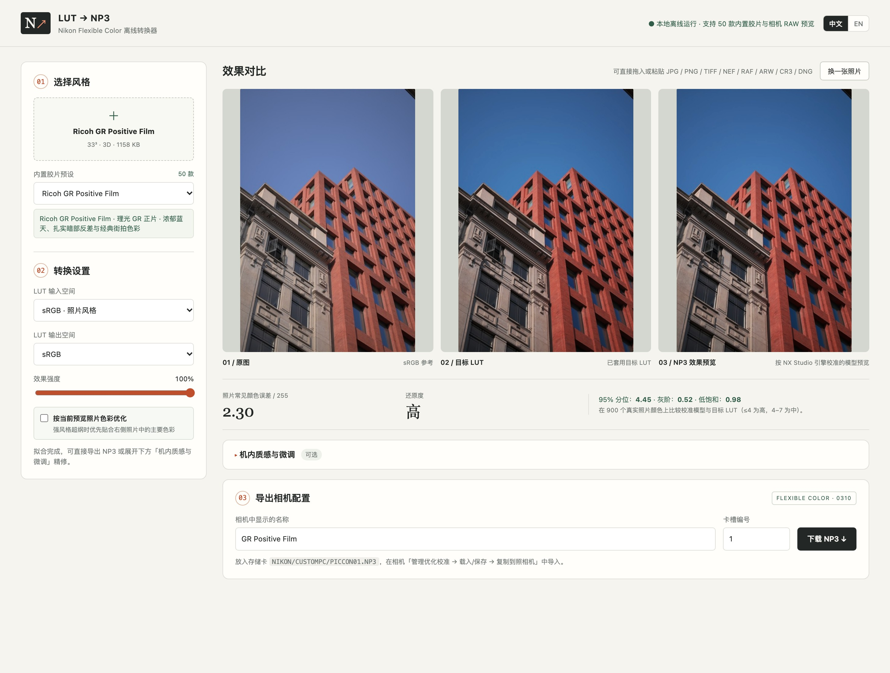
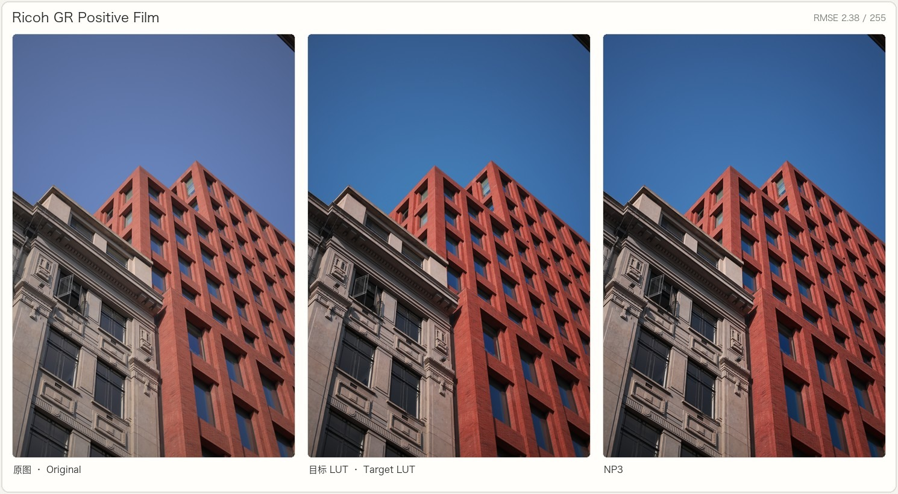
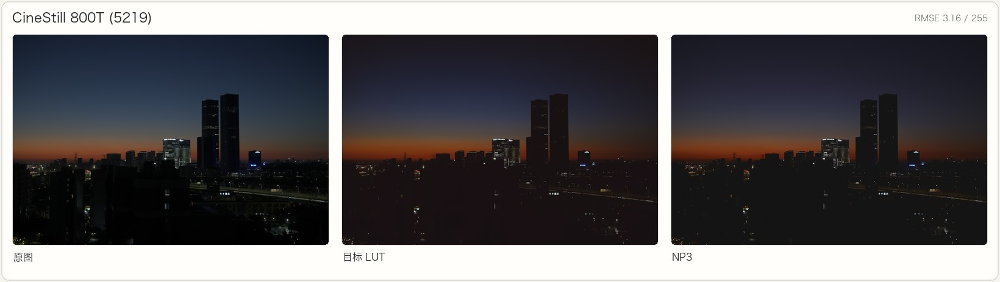
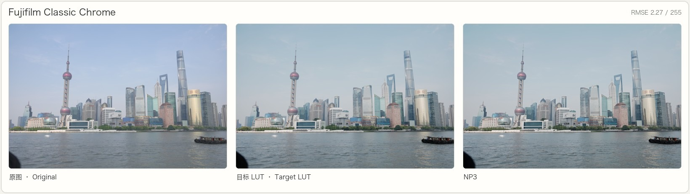
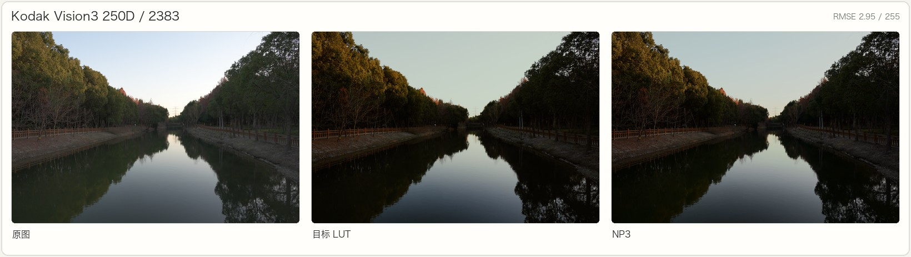
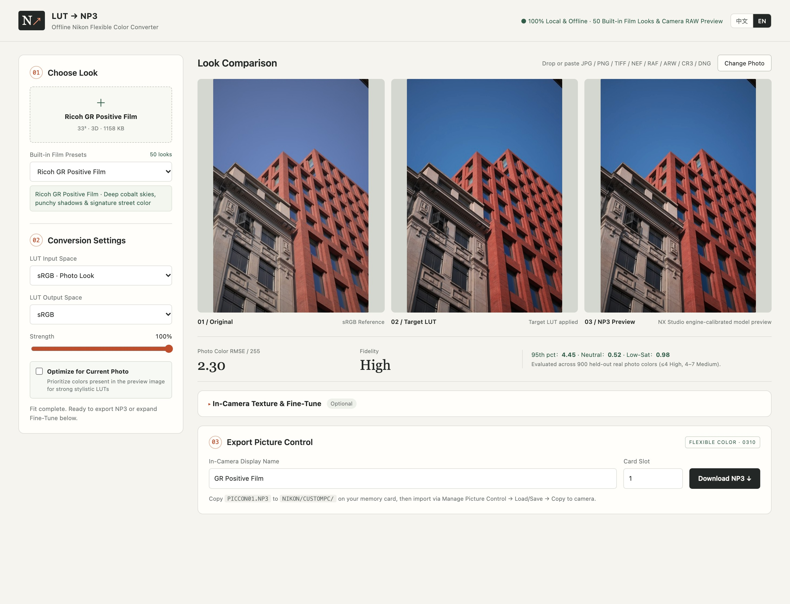

# LUT → NP3

**[简体中文](#zh) · [English](#en) · [在线使用 / Live Demo ↗](https://ycx81.github.io/lut-to-np3/)**

---

## 简体中文

将 `.cube` LUT 转换为尼康云创 / Flexible Color（`.NP3` `0310`）优化校准文件的单文件离线工具。无需安装任何环境：可直接点击 **[在线打开（GitHub Pages）↗](https://ycx81.github.io/lut-to-np3/)** 使用，也可下载 [`LUT-to-NP3.html`](./LUT-to-NP3.html) 本地离线打开（所有照片与 LUT 均在浏览器本地处理，不上传服务器；右上角支持 **中文 / EN** 切换）。

### 使用方法

1. 在线打开或用 Chrome / Edge / Safari 打开 **`LUT-to-NP3.html`**。
2. 拖入任意自定义 `.cube` 文件，或在下拉菜单直接选用内置的 **39 款 MIT 开源胶片预设**（含新增 5 款油润浓郁精选）。
3. 可拖入或粘贴自己的照片预览效果（支持 `JPG`、`PNG`、`WebP`、`AVIF`、`TIFF` 以及 `.NEF` / `.RAF` / `.ARW` / `.CR3` / `.DNG` 等主流相机 RAW）：
   - **尼康底图基准自动还原（防滤镜二次叠加）**：上传尼康 `.NEF` / 原片 `.JPG` 时自动解析机内优化校准（含云创配方 `XMP-crd` 与 257 点曲线表），支持在 Web Worker 后台通过 `17³` 逆向 LUT 自动剥离机内彩色云创／Flexible Color 滤镜（**兼容 `HE / HE★` TicoRAW 压缩**）并补偿 `Standard / Auto` 基线，还原至 `ZeroFC` 零基准预览。
   - **纯 JS 原始 RAW（Bayer）解码**：支持离线直接解码尼康 12/14-bit 无损／未压缩 `.NEF` 及 Adobe `.DNG`（无损 JPEG SOF3 / 未压缩），内置 Z 系列机身矩阵与标定 `ZeroFC` 曲线；可在顶部状态栏随时一键切换「自动还原 ZeroFC / 纯原始 RAW (Bayer) / 保留原图内嵌预览」。
4. 按需开启可选功能：
   - **相机调色基准**：默认**标准基准（Nikon Standard）**，同步补偿 ZeroFC 的亮度曲线与 BT.601 色度（`1 / 0.799 ≈ 1.252×`），使实机反差与饱和度准确匹配常规 sRGB 预览；可选 **0 基准（ZeroFC）**用于 Log 还原或柔和反差流程（微调中的「暗部黑位 / 褪色感」设为负值可进一步下压 `0–30/255` 深暗部黑位）。
   - **叠加副 LUT（2 层混调，默认折叠）**：在步骤 02 展开后可选内置胶片或加载本地 `.cube` 作为副 LUT；支持**平行混调（默认推荐，原图分别走主/副 LUT 后按比例融合，避免双重 S 曲线发闷或高光爆掉）**与**前后串联（主 LUT → 副 LUT）**两种模式，副 LUT 默认占比 `35%`，并支持一键**导出融合 `33³` `.cube`**（纯 sRGB→sRGB，可直接导入 Lightroom / DaVinci Resolve）。
   - **按当前预览照片色彩优化**：遇到超出尼康参数全局表达能力的强风格 LUT 时，优先贴合当前画面中的色彩分布。
   - **机内质感与微调**（默认折叠）：按需展开，支持微调**曝光补偿**、对比度、暗部黑位／褪色感、**白平衡（色温冷暖／色调绿品）**、**色相偏移**、饱和度偏移，以及写入机内 `.NP3` 的清晰度与锐化（含标准／胶片柔化／街拍硬朗快捷预设）。
5. 点击 **下载 NP3**，将生成的 `PICCON01.NP3`～`PICCON99.NP3` 放入存储卡 `NIKON/CUSTOMPC/` 目录，在支持 Flexible Color 的尼康机身（如 Z8 C 3.00+、Z6 III、Zf v2.0+、Z50 II、Z5 II 等）「管理优化校准 → 载入/保存 → 复制到照相机」中导入，或导入尼康工坊（NX Studio）使用。

### 转换对比（原图 / 目标 LUT / 导出 NP3）

以下对比均由 Nikon Z8 `.NEF` 原片经本工具拟合并导出 `.NP3` 后，通过尼康工坊（NX Studio）渲染引擎直接输出对比（包含用户自备厂商 LUT 及内置开源 LUT 的实测效果）：

#### Fujifilm PROVIA

#### Ricoh GR Positive Film

#### Fujifilm Velvia

#### CineStill 800T (5219)

#### Fujifilm Classic Chrome

#### Kodak Portra 400

#### Fujifilm ACROS+Ye

#### Kodak Vision3 250D / 2383

### 内置开源预设（39 款 · 全部 MIT 许可）

| 分类 | 预设列表 |
| :--- | :--- |
| **Fujifilm 开源模拟（4）** | PRO Neg. Hi、ACROS+R、ACROS+Ye、ACROS+G |
| **电影胶片与印片（5）** | Kodak Vision3 50D / 2383、Vision3 250D / 2383、Vision3 500T / 2383、CineStill 800T (5219)、Fuji Eterna Vivid / 3513 |
| **GRKit 同源配方（6）** | Kodak Aerocolor IV、Fuji Eterna 500T / 3523XD、Kodak Tri-X 400、Tri-X 红滤镜、Eastman Double-X 5222、Ilford HP5 Plus 400 |
| **经典胶卷精选（19）** | Portra 160、Portra 400、Portra 800、Gold 200、Ektar 100、Ektachrome E100D、Kodachrome 64、Fuji Pro 160C、Pro 400H、Fuji Pro 800Z、Provia 400X、Astia 100F、Velvia 50、Acros 100、Agfa Vista 200、Agfa Precisa 100、Kodak T-Max 400、Ilford Delta 100、Ilford XP2 |
| **油润浓郁精选（5）** | Kodak 2393 院线印片、Fuji Fortia SP 50、Kodak Portra 400 VC、Agfa Ultra 100、Superia X-TRA 400 |

#### 更多厂商官方 LUT（需自行下载后拖入）

出于厂商授权条款限制，本公开版未直接内置富士官方与理光官方色彩文件；你可前往以下官方页面获取 `.cube` LUT 或参考资料，下载后直接拖入本工具转换（已内置 `F-Log` / `F-Log2` / `F-Log2 C` 与 `sRGB` 输入空间支持）：

- **Fujifilm 官方 LUT 下载页**：https://www.fujifilm-x.com/global/support/download/lut/
- **Ricoh GR 图像控制官方说明**：https://www.ricoh-imaging.co.jp/english/products/gr-3/feature/03/

### 说明与开源致谢

- `.NP3`（Flexible Color `0310`）并非任意 3D LUT 容器，而是由 17 点三次样条亮度曲线、全局饱和度、8 色混合器与三段色彩分级组成的参数配置；本工具基于尼康工坊渲染引擎逐项实测标定的物理模型与双专家残差网络进行感知拟合。
- 支持 `sRGB`、`Rec.709`、`Nikon N-Log`、`Fujifilm F-Log / F-Log2 / F-Log2 C` 及自定义前置 Log 转换表输入。
- 本项目使用并遵守以下 **MIT 许可**开源项目（完整许可文本亦保留于 `LUT-to-NP3.html` 内的 `#third-party-license` 区块）：
  - [`nikon-flexible-color-picture-control`](https://github.com/tomikawa/nikon-flexible-color-picture-control) — Copyright (c) 2025 TOMIKAWA Sotaro (**MIT**)，用于 `.NP3` 二进制序列化与校验。
  - [`spectral_film_lut`](https://github.com/JanLohse/spectral_film_lut) — Copyright (c) Jan Lohse (**MIT**)，电影胶片与印片光谱模型预设来源。
  - [`GRKit`](https://github.com/ahonn/GRKit) — Copyright (c) ahonn (**MIT**)，GRKit 同源胶片配方来源。
  - [`t3mujinpack`](https://github.com/t3mujinpack/t3mujinpack) — Copyright (c) João Almeida (**MIT**)，经典胶卷 HaldCLUT 来源。
  - [`Film-Luts`](https://github.com/YahiaAngelo/Film-Luts) — Copyright (c) Yahia Angelo (**MIT**)，开源胶片、印片与 X-Trans III 模拟 LUT 来源。
  - [`derby-film`](https://github.com/joinfiber/derby-film) — Copyright (c) 2026 Derby contributors (**MIT**)，光谱建模 Superia X-TRA 400 LUT 来源。

---

## English

A single-file, 100% client-side converter that fits `.cube` LUTs into **Nikon Imaging Cloud / Flexible Color (`.NP3` `0310`)** Picture Control files. Launch directly via **[GitHub Pages (Live Web App) ↗](https://ycx81.github.io/lut-to-np3/)**, or download [`LUT-to-NP3.html`](./LUT-to-NP3.html) to run completely offline in your browser (all photos and LUTs stay on your device; supports **中文 / EN** switching in the top-right corner).

### How to Use

1. Open the live page or launch **`LUT-to-NP3.html`** in Chrome, Edge, or Safari.
2. Drop any custom `.cube` LUT file, or choose one of the **39 built-in MIT-licensed film presets** (including 5 new Rich & Glossy film looks) from the dropdown.
3. Drop or paste your own photo to preview the look (supports `JPG`, `PNG`, `WebP`, `AVIF`, `TIFF`, and `.NEF` / `.RAF` / `.ARW` / `.CR3` / `.DNG` camera RAW files):
   - **Automatic Nikon ZeroFC Baseline Recovery (No Double-Stacking)**: Automatically reads Nikon `.NEF` / camera `.JPG` Picture Control metadata (`XMP-crd` + 257-entry tone curve LUT) and strips baked-in color Imaging Cloud / Flexible Color looks via a `17³` inverse 3D LUT in a background Web Worker (**works even on proprietary Nikon `HE / HE★` TicoRAW NEFs**), plus `Standard / Auto` inverse baseline compensation.
   - **Pure-JS Raw Bayer Decoding**: Decodes 12/14-bit Nikon Lossless/Uncompressed `.NEF` and Adobe `.DNG` (Uncompressed & Lossless JPEG SOF3) directly in the browser with Z-series camera matrices and a calibrated `ZeroFC` shoulder curve; toggle anytime between *Auto ZeroFC*, *Raw Bayer*, and *Embedded Preview*.
4. Optional controls:
   - **Camera Grading Baseline**: Defaults to **Standard Baseline (Nikon Standard)**, compensating both Nikon ZeroFC tone curve and BT.601 chroma (`1 / 0.799 ≈ 1.252×`) for accurate in-camera contrast and saturation on sRGB LUTs, with a **Zero Baseline (ZeroFC)** option for Log-to-Rec.709 or direct ZeroFC workflows (negative **Black Point / Matte (Black Fade)** values also crush deep `0–30/255` shadows cleanly).
   - **Overlay Secondary LUT (2-Layer Blending, collapsed by default)**: Expand inside Step 02 to layer any built-in preset or local `.cube` file on top of your primary look. Supports **Parallel Blend (default — applies both LUTs independently and mixes them without doubling S-curve contrast)** and **Serial Chain (`Primary → Secondary`)**, defaults to `35%` overlay weight, and includes one-click **Export Merged `33³` `.cube`** (pure sRGB→sRGB for Lightroom / DaVinci Resolve).
   - **Optimize for Current Photo**: Prioritizes colors present in your current preview image when fitting strong stylistic LUTs that exceed global parameter limits.
   - **In-Camera Texture & Fine-Tune** *(collapsed by default)*: Expand to adjust **Exposure Offset**, Contrast, Black Point / Matte, **White Balance (Temp & Tint)**, **Hue Shift**, and Saturation, or configure in-camera Clarity and Sharpening written directly into the `.NP3` file (`Standard` / `Soft Film` / `Crisp Street` quick presets included).
5. Click **Download NP3 ↓**, copy the generated `PICCON01.NP3`–`PICCON99.NP3` file into `NIKON/CUSTOMPC/` on your memory card, and import it on Flexible Color-capable Nikon cameras (Z8 FW 3.00+, Z6 III, Zf FW 2.0+, Z50 II, Z5 II, etc.) via **Manage Picture Control → Load/Save → Copy to camera**, or load it directly in **Nikon NX Studio**.

### Sample Comparisons (Original / Target LUT / Exported NP3)

All 8 triptychs ([view comparisons above ↑](#compare)) are rendered directly from Nikon Z8 `.NEF` RAW files through Nikon NX Studio's engine after fitting and exporting `.NP3` files with this tool (`Original` | `Target LUT` | `NP3`).

### Built-in Presets (39 · All MIT-Licensed)

| Category | Presets |
| :--- | :--- |
| **Fujifilm Open-Source Looks (4)** | PRO Neg. Hi, ACROS+R, ACROS+Ye, ACROS+G |
| **Cinema & Print Film (5)** | Kodak Vision3 50D / 2383, Vision3 250D / 2383, Vision3 500T / 2383, CineStill 800T (5219), Fuji Eterna Vivid / 3513 |
| **GRKit Film Recipes (6)** | Kodak Aerocolor IV, Fuji Eterna 500T / 3523XD, Kodak Tri-X 400, Tri-X / Red Filter, Eastman Double-X 5222, Ilford HP5 Plus 400 |
| **Classic Film Stocks (19)** | Portra 160, Portra 400, Portra 800, Gold 200, Ektar 100, Ektachrome E100D, Kodachrome 64, Fuji Pro 160C, Pro 400H, Fuji Pro 800Z, Provia 400X, Astia 100F, Velvia 50, Acros 100, Agfa Vista 200, Agfa Precisa 100, Kodak T-Max 400, Ilford Delta 100, Ilford XP2 |
| **Rich & Glossy Film (5)** | Kodak 2393 Print, Fuji Fortia SP 50, Kodak Portra 400 VC, Agfa Ultra 100, Superia X-TRA 400 |

#### Official Vendor LUTs (Download Separately)

To respect vendor licensing terms, proprietary Fujifilm and Ricoh LUT files are not bundled in this public distribution. You can download official `.cube` LUTs directly from the vendors and drop them into the app (`F-Log` / `F-Log2` / `F-Log2 C` and `sRGB` input spaces are built in):

- **Fujifilm Official LUT Downloads**: https://www.fujifilm-x.com/global/support/download/lut/
- **Ricoh GR Image Control Reference**: https://www.ricoh-imaging.co.jp/english/products/gr-3/feature/03/

### Technical Notes & Third-Party Licenses

- `.NP3` (Flexible Color `0310`) is a parametric Picture Control consisting of a 17-point natural cubic spline tone curve, global saturation, an 8-hue Color Blender, and 3-zone Color Grading. This tool fits looks perceptually using a physics-based forward model and a dual-expert residual MLP calibrated directly against Nikon NX Studio's rendering engine.
- Supports `sRGB`, `Rec.709`, `Nikon N-Log`, `Fujifilm F-Log / F-Log2 / F-Log2 C`, and custom Pre-LUT Log transforms.
- **Open-Source Attributions (MIT License)** — full license texts are also embedded inside `LUT-to-NP3.html` (`#third-party-license`):
  - [`nikon-flexible-color-picture-control`](https://github.com/tomikawa/nikon-flexible-color-picture-control) — Copyright (c) 2025 TOMIKAWA Sotaro (**MIT**) — `.NP3` binary serialization.
  - [`spectral_film_lut`](https://github.com/JanLohse/spectral_film_lut) — Copyright (c) Jan Lohse (**MIT**) — Cinema & print film LUTs.
  - [`GRKit`](https://github.com/ahonn/GRKit) — Copyright (c) ahonn (**MIT**) — GRKit film recipes.
  - [`t3mujinpack`](https://github.com/t3mujinpack/t3mujinpack) — Copyright (c) João Almeida (**MIT**) — Classic film stock HaldCLUTs.
  - [`Film-Luts`](https://github.com/YahiaAngelo/Film-Luts) — Copyright (c) Yahia Angelo (**MIT**) — Open-source film, print & X-Trans III LUTs.
  - [`derby-film`](https://github.com/joinfiber/derby-film) — Copyright (c) 2026 Derby contributors (**MIT**) — Spectral Superia X-TRA 400 LUT.
