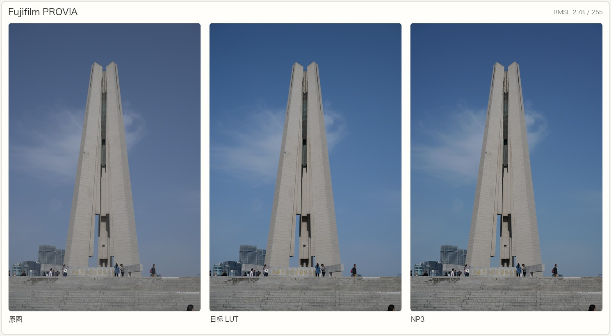
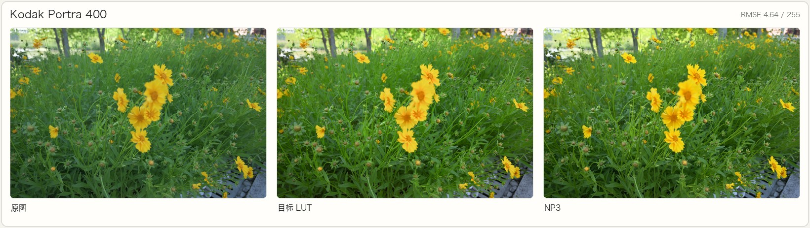

# LUT → NP3

将 `.cube` LUT 转换为尼康云创 / Flexible Color（`.NP3` `0310`）优化校准文件的单文件离线工具。无需安装任何环境或联网，直接用浏览器打开 [`LUT-to-NP3.html`](./LUT-to-NP3.html) 即可使用。

## 使用方法

1. 用 Chrome / Edge / Safari 打开 **`LUT-to-NP3.html`**。
2. 拖入自定义 `.cube` 文件，或直接在下拉菜单选用内置的 **50 款胶片／相机模拟预设**。
3. 可拖入或粘贴自己的照片预览效果（支持 `JPG`、`PNG`、`WebP`、`AVIF`、`TIFF` 以及 `.NEF` / `.RAF` / `.ARW` / `.CR3` / `.DNG` 等主流相机 RAW 内嵌预览）。
4. 按需开启可选功能：
   - **按当前预览照片色彩优化**：遇到超出尼康参数全局表达能力的强风格 LUT 时，优先贴合当前画面中的色彩分布。
   - **机内质感与微调**：在保持中性灰不偏色的前提下微调饱和度、暗部黑位／褪色感、对比度，或设置写入机内 `.NP3` 的清晰度与锐化（含标准／胶片柔化／街拍硬朗快捷预设）。
5. 点击 **下载 NP3**，将生成的 `PICCON01.NP3`～`PICCON99.NP3` 放入存储卡 `NIKON/CUSTOMPC/` 目录，在支持 Flexible Color 的尼康机身（如 Z8 C 3.00+、Z6 III、Zf v2.0+、Z50 II、Z5 II 等）「管理优化校准 → 载入/保存 → 复制到照相机」中导入，或导入尼康工坊（NX Studio）使用。

## 转换对比（原图 / 目标 LUT / 导出 NP3）

以下对比均由 Nikon Z8 `.NEF` 原片经本工具拟合并导出 `.NP3` 后，通过尼康工坊（NX Studio）渲染引擎直接输出对比：

### Fujifilm PROVIA

### Ricoh GR Positive Film

### Fujifilm Velvia

### CineStill 800T (5219)

### Fujifilm Classic Chrome

### Kodak Portra 400

### Fujifilm ACROS+Ye

### Kodak Vision3 250D / 2383

## 内置预设（50 款）

| 分类 | 预设列表 |
| :--- | :--- |
| **Fujifilm 胶片模拟（15）** | PROVIA、Velvia、ASTIA、Classic Chrome、Classic Neg、REALA ACE、PRO Neg. Std、PRO Neg. Hi、ETERNA、ETERNA Bleach Bypass、Wide Dynamic Range、ACROS、ACROS+R、ACROS+Ye、ACROS+G |
| **Ricoh GR 胶片模拟（5）** | GR Positive Film、GR Negative Film、GR Vivid、GR Monotone、GR Soft Mono |
| **电影胶片与印片（5）** | Kodak Vision3 50D / 2383、Vision3 250D / 2383、Vision3 500T / 2383、CineStill 800T (5219)、Fuji Eterna Vivid / 3513 |
| **GRKit 同源配方（6）** | Kodak Aerocolor IV、Fuji Eterna 500T / 3523XD、Kodak Tri-X 400、Tri-X 红滤镜、Eastman Double-X 5222、Ilford HP5 Plus 400 |
| **经典胶卷精选（19）** | Portra 160、Portra 400、Portra 800、Gold 200、Ektar 100、Ektachrome E100D、Kodachrome 64、Fuji Pro 160C、Pro 400H、Fuji Pro 800Z、Provia 400X、Astia 100F、Velvia 50、Acros 100、Agfa Vista 200、Agfa Precisa 100、Kodak T-Max 400、Ilford Delta 100、Ilford XP2 |

## 说明

- `.NP3`（Flexible Color `0310`）并非任意 3D LUT 容器，而是由 17 点三次样条亮度曲线、全局饱和度、8 色混合器与三段色彩分级组成的参数配置；本工具基于尼康工坊渲染引擎逐项实测标定的物理模型与双专家残差网络进行感知拟合。
- 支持 `sRGB`、`Rec.709`、`Nikon N-Log`、`Fujifilm F-Log / F-Log2 / F-Log2 C` 及自定义前置 Log 转换表输入。
