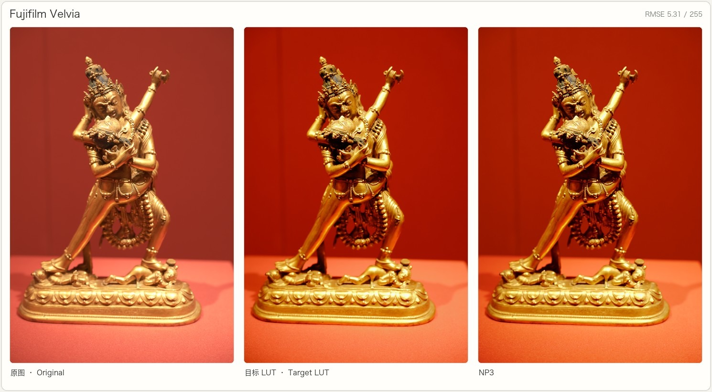
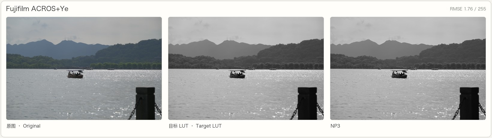

# LUT → NP3

**[简体中文](#zh) · [English](#en)**

---

## 简体中文

将 `.cube` LUT 转换为尼康云创 / Flexible Color（`.NP3` `0310`）优化校准文件的单文件离线工具。无需安装任何环境或联网，直接用浏览器打开 [`LUT-to-NP3.html`](./LUT-to-NP3.html) 即可使用（右上角支持 **中文 / EN** 界面切换）。

### 使用方法

1. 用 Chrome / Edge / Safari 打开 **`LUT-to-NP3.html`**。
2. 拖入自定义 `.cube` 文件，或直接在下拉菜单选用内置的 **50 款胶片／相机模拟预设**。
3. 可拖入或粘贴自己的照片预览效果（支持 `JPG`、`PNG`、`WebP`、`AVIF`、`TIFF` 以及 `.NEF` / `.RAF` / `.ARW` / `.CR3` / `.DNG` 等主流相机 RAW 内嵌预览）。
4. 按需开启可选功能：
   - **按当前预览照片色彩优化**：遇到超出尼康参数全局表达能力的强风格 LUT 时，优先贴合当前画面中的色彩分布。
   - **机内质感与微调**（默认折叠）：按需展开，可在保持中性灰不偏色的前提下微调饱和度、暗部黑位／褪色感、对比度，或设置写入机内 `.NP3` 的清晰度与锐化（含标准／胶片柔化／街拍硬朗快捷预设）。
5. 点击 **下载 NP3**，将生成的 `PICCON01.NP3`～`PICCON99.NP3` 放入存储卡 `NIKON/CUSTOMPC/` 目录，在支持 Flexible Color 的尼康机身（如 Z8 C 3.00+、Z6 III、Zf v2.0+、Z50 II、Z5 II 等）「管理优化校准 → 载入/保存 → 复制到照相机」中导入，或导入尼康工坊（NX Studio）使用。

### 转换对比（原图 / 目标 LUT / 导出 NP3）

以下对比均由 Nikon Z8 `.NEF` 原片经本工具拟合并导出 `.NP3` 后，通过尼康工坊（NX Studio）渲染引擎直接输出对比：

#### Fujifilm PROVIA

#### Ricoh GR Positive Film

#### Fujifilm Velvia

#### CineStill 800T (5219)

#### Fujifilm Classic Chrome

#### Kodak Portra 400

#### Fujifilm ACROS+Ye

#### Kodak Vision3 250D / 2383

### 内置预设（50 款）

| 分类 | 预设列表 |
| :--- | :--- |
| **Fujifilm 胶片模拟（15）** | PROVIA、Velvia、ASTIA、Classic Chrome、Classic Neg、REALA ACE、PRO Neg. Std、PRO Neg. Hi、ETERNA、ETERNA Bleach Bypass、Wide Dynamic Range、ACROS、ACROS+R、ACROS+Ye、ACROS+G |
| **Ricoh GR 胶片模拟（5）** | GR Positive Film、GR Negative Film、GR Vivid、GR Monotone、GR Soft Mono |
| **电影胶片与印片（5）** | Kodak Vision3 50D / 2383、Vision3 250D / 2383、Vision3 500T / 2383、CineStill 800T (5219)、Fuji Eterna Vivid / 3513 |
| **GRKit 同源配方（6）** | Kodak Aerocolor IV、Fuji Eterna 500T / 3523XD、Kodak Tri-X 400、Tri-X 红滤镜、Eastman Double-X 5222、Ilford HP5 Plus 400 |
| **经典胶卷精选（19）** | Portra 160、Portra 400、Portra 800、Gold 200、Ektar 100、Ektachrome E100D、Kodachrome 64、Fuji Pro 160C、Pro 400H、Fuji Pro 800Z、Provia 400X、Astia 100F、Velvia 50、Acros 100、Agfa Vista 200、Agfa Precisa 100、Kodak T-Max 400、Ilford Delta 100、Ilford XP2 |

### 说明

- `.NP3`（Flexible Color `0310`）并非任意 3D LUT 容器，而是由 17 点三次样条亮度曲线、全局饱和度、8 色混合器与三段色彩分级组成的参数配置；本工具基于尼康工坊渲染引擎逐项实测标定的物理模型与双专家残差网络进行感知拟合。
- 支持 `sRGB`、`Rec.709`、`Nikon N-Log`、`Fujifilm F-Log / F-Log2 / F-Log2 C` 及自定义前置 Log 转换表输入。

---

## English

A single-file, 100% offline converter that fits `.cube` LUTs into **Nikon Imaging Cloud / Flexible Color (`.NP3` `0310`)** Picture Control files. No installation, server, or internet connection required — simply open [`LUT-to-NP3.html`](./LUT-to-NP3.html) in your browser (supports **中文 / EN** language switching in the top-right corner).

### How to Use

1. Open **`LUT-to-NP3.html`** in Chrome, Edge, or Safari.
2. Drop a custom `.cube` LUT file, or choose one of the **50 built-in film & camera simulation presets** from the dropdown.
3. Drop or paste your own photo to preview the look (supports `JPG`, `PNG`, `WebP`, `AVIF`, `TIFF`, and embedded previews from `.NEF` / `.RAF` / `.ARW` / `.CR3` / `.DNG` camera RAW files).
4. Optional controls:
   - **Optimize for Current Photo**: Prioritizes colors present in your current preview image when fitting strong stylistic LUTs that exceed global parameter limits.
   - **In-Camera Texture & Fine-Tune** *(collapsed by default)*: Expand to adjust saturation, black point / matte fade, and contrast without introducing neutral gray casts, or configure in-camera Clarity and Sharpening written directly into the `.NP3` file (`Standard` / `Soft Film` / `Crisp Street` quick presets included).
5. Click **Download NP3 ↓**, copy the generated `PICCON01.NP3`–`PICCON99.NP3` file into `NIKON/CUSTOMPC/` on your memory card, and import it on Flexible Color-capable Nikon cameras (Z8 FW 3.00+, Z6 III, Zf FW 2.0+, Z50 II, Z5 II, etc.) via **Manage Picture Control → Load/Save → Copy to camera**, or load it directly in **Nikon NX Studio**.

### Sample Comparisons (Original / Target LUT / Exported NP3)

All 8 triptychs ([view comparisons above ↑](#compare)) are rendered directly from Nikon Z8 `.NEF` RAW files through Nikon NX Studio's engine after fitting and exporting `.NP3` files with this tool (`Original` | `Target LUT` | `NP3`).

### Built-in Presets (50)

| Category | Presets |
| :--- | :--- |
| **Fujifilm Film Simulations (15)** | PROVIA, Velvia, ASTIA, Classic Chrome, Classic Neg, REALA ACE, PRO Neg. Std, PRO Neg. Hi, ETERNA, ETERNA Bleach Bypass, Wide Dynamic Range, ACROS, ACROS+R, ACROS+Ye, ACROS+G |
| **Ricoh GR Looks (5)** | GR Positive Film, GR Negative Film, GR Vivid, GR Monotone, GR Soft Mono |
| **Cinema & Print Film (5)** | Kodak Vision3 50D / 2383, Vision3 250D / 2383, Vision3 500T / 2383, CineStill 800T (5219), Fuji Eterna Vivid / 3513 |
| **GRKit Film Recipes (6)** | Kodak Aerocolor IV, Fuji Eterna 500T / 3523XD, Kodak Tri-X 400, Tri-X / Red Filter, Eastman Double-X 5222, Ilford HP5 Plus 400 |
| **Classic Film Stocks (19)** | Portra 160, Portra 400, Portra 800, Gold 200, Ektar 100, Ektachrome E100D, Kodachrome 64, Fuji Pro 160C, Pro 400H, Fuji Pro 800Z, Provia 400X, Astia 100F, Velvia 50, Acros 100, Agfa Vista 200, Agfa Precisa 100, Kodak T-Max 400, Ilford Delta 100, Ilford XP2 |

### Technical Notes

- `.NP3` (Flexible Color `0310`) is not an arbitrary 3D LUT container — it is a parametric Picture Control consisting of a 17-point natural cubic spline tone curve, global saturation, an 8-hue Color Blender, and 3-zone Color Grading. This tool fits looks perceptually using a physical forward model and a dual-expert residual network calibrated directly against Nikon NX Studio's rendering engine.
- Supports `sRGB`, `Rec.709`, `Nikon N-Log`, `Fujifilm F-Log / F-Log2 / F-Log2 C`, and custom Pre-LUT Log transforms.
